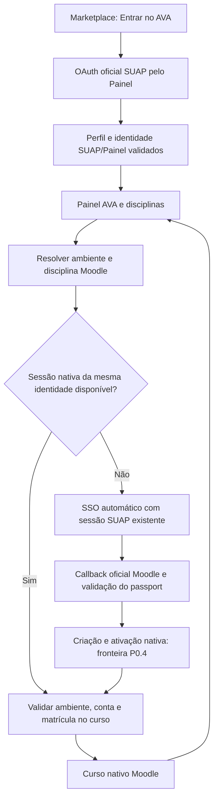

# P0.5 — identidade SUAP, Painel e sessão Moodle

Data: 2026-11-01. Fonte analisado: `fix/p0-release-2.0.1`, `5f88fd805653d0bc6d8d816332bdf06df14ec41e`. Nenhuma alteração de produção foi aplicada.

**SUAP é a autoridade primária da identidade. Sessão Moodle é uma credencial interna por ambiente para acessar cursos; não substitui essa autoridade.** O app instalado é de proveniência diferente, por isso o fluxo abaixo distingue leitura do fonte e teste real de uma sessão já aberta.

## Visão do fluxo atual no fonte



O ramo automático não significa fornecer novamente a senha ao Moodle, tratar JWT SUAP como wstoken ou utilizar credencial de integração institucional como sessão de estudante.

## 1. Entrada e sessão principal SUAP/Painel

### Caminho acionado pelo Marketplace

`MarketplaceIfrnPage.enterAva()` chama **`SuapEntryService.loginWithSuap()`**, após a transição de entrada. Esse é o caminho atual encontrado no código; comentários antigos de OAuth nativo em outras partes não mudam essa chamada efetiva.

`loginWithSuap()` solicita `PainelAvaService.authenticateWithBrowser({readOnly:true,reuseSession:false})`. A autenticação usa a sessão web oficial SUAP/Painel em InAppBrowser. A tela de credenciais principal aparece quando necessária; páginas intermediárias ficam ocultas. Não é requisito criar primeiro uma conta no Moodle Acadêmico para obter o Painel.

O início de um **novo login principal** configura limpeza de cookies do IAB para não reaproveitar a conta web anterior. Isso faz parte do código existente, mas **não foi executado nesta fase**, pois não houve logout nem novo login.

### Identidade, perfil e disciplinas

A configuração local aponta para `https://ava.ifrn.edu.br`, admite a origem exata `https://painel.ead.ifrn.edu.br` para navegação web e utiliza `GET /api/v1/diarios/`. O perfil prefere `/api/v2/usuario/info/`; há consultas alternativas de identidade no SUAP na mesma sessão web. Esses caminhos foram identificados no fonte; status HTTP e payload autenticado de cada domínio **não foram revalidados** nesta etapa.

O resultado `readOnly` não grava imediatamente o perfil/dashboard. `loginWithSuap()` verifica identidade presente, owner correspondente, identidade esperada quando fornecida e estrutura da lista de diários. Só então prepara os dados e chama `commit()`.

O commit guarda perfil e dashboard da mesma conta, owner e snapshot OAuth. Dados anteriores só são reaproveitados com vínculo à identidade; foto e informações de perfil não podem ser copiadas de outra pessoa por semelhança de nome.

### Persistência principal

`AuthService.saveOAuthSession()` usa `saveOAuthProfile()`, salva o username e o perfil e remove JWTs locais incompatíveis com o modo OAuth. O snapshot em `ifrn_suap_oauth_profile_v1` contém perfil, identidade e expiração, **não é token SUAP nem sessão Moodle**.

O prazo local máximo de 30 dias é prazo de cache do perfil. Ele não prolonga cookies SUAP, tokens do servidor ou uma sessão Moodle. `readOAuthProfile()` valida identidade/expiração; `readOAuthDashboard()` só restaura dashboard cujo owner corresponde ao snapshot e ao armazenamento de origem.

Na retomada, o Marketplace pode abrir o Painel se a sessão local e o dashboard estiverem disponíveis. Isso explica entrar diretamente no Painel sem novo formulário; não prova, sozinho, que cada servidor foi consultado novamente.

### Outros caminhos que não devem ser confundidos

- `SuapEntryService.login()/complete()` contém um caminho de retorno OAuth via Moodle Acadêmico, com verificação de identidade e enriquecimento de perfil pelo Painel. Não é a chamada inicial atual de `enterAva()`.
- `AuthService.login()/refresh()/verify()` implementa o modo JWT SUAP. A existência desses métodos não prova que o Marketplace atual exige esse modo ou uma segunda autenticação.
- `IfrnLoginPage` atualmente redireciona ao Marketplace para compatibilidade/recuperação. Não é um novo formulário Moodle independente.

Esses mecanismos não foram removidos nem declarados mortos. A proposta P0.5 não modifica o login principal ou a validação de identidade existente.

## 2. Seleção da disciplina e sessão interna Moodle

`PainelPage.handleOpenCourse()` recebe o id Moodle, nome e site da disciplina. `resolveCourseSite` confirma o ambiente. O host do Painel e o host do curso são responsabilidades diferentes: uma conta no Painel não é um site Moodle nativo.

`MoodleSiteService.ensureSessionAndOpenCourse()` associa a tentativa à disciplina/ambiente e chama `ensureMatchingMoodleSession()`:

1. Reutiliza a sessão atual se ambiente, estado de login e identidade coincidem.
2. Pode localizar e carregar um site já armazenado da mesma conta/ambiente, sem pedir senha novamente.
3. Não usa `loadSite` como prova de uma sessão válida quando o registro está logged-out ou sem token utilizável.
4. Diante de identidade diferente, apresenta recuperação e não toma o nome da pessoa como evidência de correspondência.
5. Na falta de sessão reutilizável, prepara o ramo SSO do curso.

Os candidatos de identidade seguem a prioridade existente de matrícula/username/identificação canônica do perfil e login SUAP. O nome de exibição não serve como chave. A proposta deve manter essa política, não ampliar correspondências por conveniência.

Antes de abrir o curso, o fluxo confirma site ativo, identidade esperada e presença do id exato na lista de cursos matriculados da sessão nativa. A autorização do curso não é inferida somente da presença de um card no Painel.

### SSO automático de curso

`performStartSuapOAuthLogin()` verifica configuração pública e provedor. `openCourseOAuthInApp()` prepara o lançamento oficial e usa uma janela de curso oculta em `auth/suap/login.php`, com os cookies da sessão principal preservados.

O app reconhece o callback móvel e entrega o token ao handler oficial Moodle, que valida o passport e cria/ativa a sessão nativa. Se a janela encontra formulário de senha/consentimento, o helper não introduz uma segunda autenticação manual oculta nem preenche credenciais: informa a necessidade de renovação no login principal ou de autorização institucional.

`wstoken/privateToken` Moodle pertencem ao ambiente/conta Moodle. Não são `access_token/refresh_token` SUAP. O snapshot OAuth do perfil também não substitui nenhum deles.

## 3. Cancelamento, publicação tardia e retorno

O controle IFRN já fecha o browser, libera listeners, mantém timeout durante aceitação e invalida geração/epoch. Isso encerra a **tentativa lógica** e evita alguns callbacks posteriores ao cancelamento.

A pendência ocorre depois de o callback já entrar no núcleo. Enquanto A aguarda `fetchSiteInfo`, lookup/configuração ou persistência, o usuário pode cancelar e iniciar B. O núcleo não consulta a geração SUAP/IFRN ao continuar:

```text
A entra no handler oficial → aguarda resposta
IFRN cancela A → B torna-se a tentativa válida
B conclui ou continua pendente
resposta de A chega → núcleo persiste/ativa A → LOGIN → navegação antiga
verificação IFRN depois do await detecta a obsolescência tarde demais
```

Mesmo sem trocar de matrícula, A_OLD pode sobrescrever a credencial mais nova de A_NEW no mesmo siteId. Portanto apenas comparar a conta ao final não basta; o proprietário inclui revisão da autenticação.

O `LOGIN` nativo não deve criar ou substituir uma identidade principal SUAP por si só. Filtrar esse evento no IFRN não desfaz a persistência nem a troca de currentSite já realizadas. A proposta de `10-proposta-integracao-core.md` exige cooperação na preparação/publicação e na navegação interna.

Quando o curso abre corretamente, flags de origem indicam que o botão Voltar na página principal deve retornar ao Painel. Navegações internas de atividades e overlays continuam sendo delegadas ao Moodle/Ionic. Não deve haver logout ao simplesmente voltar do curso.

## 4. Logout principal e recuperação

O caminho visual existente é **foto do estudante → Sair**. `App.logout()` limpa dados locais do Painel e chama o bridge; `PainelPage.handleLogout()` chama `AuthService.logout()`, `PainelAvaService.clearSession()` e navega ao Marketplace.

As correções P0 locais removem as flags atuais/legadas pelo helper compartilhado e invalidam o epoch. Esse logout local **não equivale a revogar todos os tokens Moodle ou todas as sessões web SUAP no servidor**. O próximo login principal tem sua própria política de cookies, e sessões Moodle ainda precisam de verificação de identidade antes de reutilização.

Os métodos de recuperação de conta podem abrir a saída web oficial de um ambiente por escolha explícita. Isso não faz parte do simples retorno ao Painel e não foi acionado nesta fase.

## 5. O que o Android comprovou nesta fase

Com a sessão que já existia no aparelho, Painel, disciplinas, uma abertura Presencial, uma Acadêmica e ambos os retornos funcionaram. As rotas correspondiam aos cursos solicitados; conteúdo nativo renderizou 14 e 11 módulos respectivamente.

Os marcadores de reutilização/identidade ocorreram duas vezes, sem marcador de início de SSO. Portanto foi exercitado o **caminho normal com sessão disponível**, não a criação de uma nova sessão Moodle nem um novo login SUAP.

A identidade real não foi exportada nem comparada com a matrícula fornecida. As credenciais não foram usadas. O APK instalado difere do local e não tem os marcadores de geração/epoch desta branch. Assim, o resultado não certifica os P0 nem demonstra como a versão instalada se comportaria após logout ou expiração. Detalhes e hashes: `11-android-usb-baseline.md`.

## 6. Responsabilidades que a correção deve preservar

| Responsabilidade | Autoridade e limite |
|---|---|
| Quem é o estudante | Login/identidade SUAP/Painel atual, com verificação de owner; nunca nome ou conta Moodle escolhida por efeito tardio. |
| Dados do Painel | Perfil/dashboard da mesma identidade e ambiente de API; snapshot é cache, não credencial de servidor. |
| Sessão nativa de um Moodle | Token validado pelo Moodle, site exato e identidade correspondente à principal. |
| Publicar uma sessão | Somente tentativa atual e revisão válida; não pode ser consequência de A cancelada. |
| Abrir disciplina | Id exato, ambiente e matrícula na sessão nativa validada. |
| Voltar ao Painel | Navegação normal, sem novo login ou logout. |
| Sair/trocar conta | Ação explícita que invalida o proprietário anterior; limpar somente o estado correspondente. |

## 7. Pendências

- Especificar o contrato de publicação/fencing e de lançamento SSO por tentativa, conforme proposta 10.
- Resolver as sete falhas sintéticas de isolamento, preservando o teste vermelho até haver correção completa.
- Depois da implementação aprovada, executar suíte ampliada, TypeScript e lint e preparar build identificável.
- Com autorização separada, instalar a build de teste e verificar login novo SUAP, expiração, recuperação, logout e troca de conta. Não usar a sessão atual como laboratório de concorrência destrutiva.
- Confirmar separadamente respostas autenticadas/identidade dos ambientes, sem assumir que os domínios do Painel são aliases.

Não houve alteração de fonte, branch, instalação ou novo login manual nesta investigação. Nenhum dado de aluno ou credencial foi utilizado nos testes automatizados de concorrência; a baseline Android apenas reutilizou a sessão preexistente para a navegação normal autorizada.
